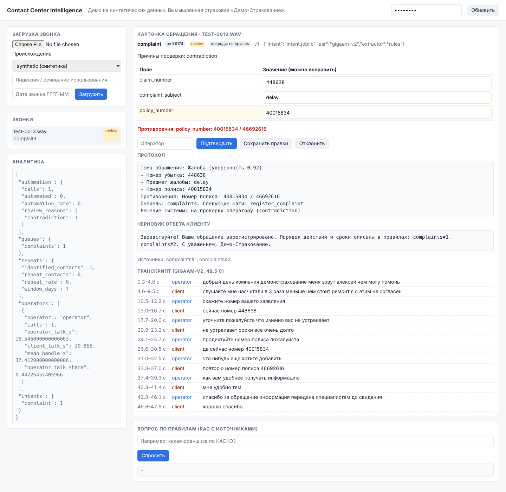

# contact-center-intelligence

**From a recorded insurance call to a verified case card: Russian ASR with timestamps,
speaker roles, structured fields, contradictions, protocol, grounded answers with sources,
and an explicit automate-or-review decision.**

| | |
|---|---|
| **Problem** | Operators spend after-call work typing summaries and case fields; number errors cause rework and repeat contacts; automation without a confidence signal is unsafe. |
| **For** | Insurance and banking contact centers; their DS/NLP teams. |
| **Data** | 900 **synthetic** calls (9 intents) generated from gold cases and rendered with CC0 TTS voices; family-disjoint train/dev/test phrasings; telephony and noise conditions. No real customer data. |
| **Stack** | sherpa-onnx (GigaAM-v2, Parakeet-TDT-0.6B-v3, Whisper-small, Silero VAD, pyannote-seg + ERes2Net diarization), scikit-learn, Qwen3-1.7B and Qwen3-Embedding-0.6B via llama.cpp (local, OpenAI-compatible API), FastAPI, PostgreSQL job queue, MLflow tracking + registry, Airflow 3 nightly DAG. |

## Run

```bash
python -m venv .venv && . .venv/bin/activate && pip install -e '.[dev]'
pytest -q                                   # unit, API, queue, retries (no models needed)
scripts/fetch_models.sh models              # ~1 GB ONNX speech models
cci corpus && cci render --split test --condition telephony --limit 5
cci eval-asr --split test --condition telephony --limit 5 --diarization
cci train-intent                            # MLflow run + registry alias "champion"
CCI_API_KEY=demo CCI_INTENT_MODEL_URI=models/intent/intent.joblib cci serve & cci worker
```
Open `http://127.0.0.1:8090`, paste the key, upload a WAV with provenance `synthetic`.



## Measured results (CPU, synthetic speech)

Full report with CIs: [results/REPORT.md](results/REPORT.md). Protocol: [docs/EVALUATION.md](docs/EVALUATION.md).

**ASR, 60 test calls (34 min of audio), WER with numbers normalized on both sides**

| condition | GigaAM-v2 | Parakeet-TDT-0.6B-v3 | Whisper-small |
|---|---:|---:|---:|
| clean | **9.2%** (8.3-10.1) | 14.6% (13.2-16.1) | 29.7% (27.8-31.7) |
| telephony (8 kHz, mu-law) | **9.3%** (8.4-10.2) | 16.4% (14.5-18.3) | 31.6% (29.5-33.5) |
| telephony + noise 10 dB | **9.4%** (8.3-10.4) | 23.1% (20.7-25.5) | not run |
| real-time factor (telephony, 4 CPU threads) | 0.14 | 0.11 | 0.40 |

GigaAM-v2 (Russian-specific) is the default: best WER in every condition and robust to the
telephone channel and noise. Diarization on telephony audio: DER 0.108. Operator/client roles
from a script-cue heuristic were 0.896 accurate (26/150 test calls < 0.9); a text role model
selected on dev raises this to 0.9985 with no call below 0.9 ([ADR-B8](docs/adr/ADR-B8-role-assignment.md)).

**Early routing: intent from the client's first utterance** (test, 150 calls; `[60]` = first 60, where the LLM ran)

| model | reference | ASR (telephony) | LLM paraphrase [60] |
|---|---:|---:|---:|
| TF-IDF + logistic regression | 0.547 (0.467-0.627) | 0.580 | 0.450 |
| Qwen3-Embedding-0.6B + logistic regression | **0.807** (0.740-0.867) | **0.800** | **0.717** |
| Qwen3-1.7B zero-shot [60] | 0.467 | 0.433 | 0.533 |

Accuracy with 95% bootstrap CI; macro-F1 in the report. Test openings use a phrasing family
never seen in training. Intent from the *full* transcript is 1.0 for every model and is not
informative here (operator questions are intent-specific by construction).

**Case extraction** (micro P/R over the gold intent's fields)

| extractor | reference | ASR | paraphrase [60] | contradictions (ASR) |
|---|---:|---:|---:|---:|
| rules v1.0 (frozen) | 1.000 (upper bound) | P 0.951 / R 0.796 | P 0.986 / R 0.936 | F1 0.00 |
| rules v1.1 (post-hoc, dev-developed) | 1.000 | P 0.952 / R 0.818 | P 0.986 / R 0.936 | F1 1.00 (7 calls) |
| Qwen3-1.7B, JSON schema [60] | P 0.555 / R 0.487 | P 0.456 / R 0.397 | P 0.571 / R 0.462 | F1 0.04 |

The frozen rules missed every contradiction on ASR text because an operator cue was matched as
the literal "что-нибудь еще" while ASR writes "что нибудь еще"; the fix was developed on dev
transcripts and its test numbers are labelled post-hoc. The local 1.7B model is far behind the
rules: it leaves preference fields empty and invents values (checked on dev calls), at 17 s per call.

**Automate or review** (ASR condition, rules v1.1, 150 test calls)

| policy | automated | error rate on automated cases |
|---|---:|---:|
| automate everything | 100% | 38.0% |
| review when a required field is missing or contradicted | 55.3% | **8.4%** (7 cases) |
| + intent-confidence threshold | 0% | - |

No intent-confidence threshold reached the 2% target on dev, so the selective policy routes
everything to review: errors come from fields (ASR on product names such as "ОСАГО" ->
"осада"), not from intent. The honest conclusion is that this pipeline can pre-fill cards for
operators but should not close cases automatically on this ASR quality.

**Knowledge-base answers** (40 questions, fictional rulebook, same Qwen3-1.7B)

| | closed book | grounded (hybrid BM25 + dense, top 3) |
|---|---:|---:|
| fully correct answers | 5% | **80%** |
| fact recall | 9.6% | 81.2% |
| numbers verified against cited chunk | - | 85% of answers |
| citation precision | - | 90% |

Retrieval recall@3: BM25 0.975, dense 1.0, hybrid 1.0. The closed-book row is low by design:
the rulebook is fictional, so it measures how often the model answers without knowing.

## What the product does (and where)

| Function | Code |
|---|---|
| Upload with declared provenance; SHA-256 dedup; durable job | `src/cci/app/api.py`, `app/db.py` |
| VAD, ASR with timestamps, diarization, roles | `src/cci/speech/` |
| Russian numeral normalization (words <-> digits, dictated groups) | `src/cci/domain/ru_numbers.py` |
| Intent: TF-IDF / embeddings / LLM zero-shot | `src/cci/nlp/intent.py` |
| Extraction: rules with corrections & contradictions / LLM JSON schema | `src/cci/nlp/rules.py`, `nlp/llm_extract.py` |
| Case: required fields, queue, next actions, review reasons, protocol, reply draft with sources | `src/cci/nlp/case.py` |
| Grounded answers with citation and numeric verification | `src/cci/rag/` |
| Operator corrections with optimistic locking, audit trail | `PATCH /v1/calls/{id}/case` |
| Analytics: repeat contacts, queues, operator load, automation | `src/cci/analytics/metrics.py`, `GET /v1/analytics` |
| MLflow registry with quality gate; Airflow nightly DAG | `src/cci/training.py`, `airflow/dags/cci_nightly.py` |

## Responsible use

Uploads require provenance `synthetic`, `licensed` or `consented_recording`. Routing and
recommendations use only the stated intent and explicitly stated preferences; no emotion,
demographic or health inference; no automated insurance decisions ([ADR-B4](docs/adr/ADR-B4-no-sensitive-inference.md)).
TTS voices were selected by dataset license ([ADR-B3](docs/adr/ADR-B3-tts-voice-licensing.md)).

## Limits

* Synthetic TTS speech: no overlaps, accents or spontaneous disfluency. WER here validates the
  pipeline and ranks the models under identical conditions; it is not production accuracy.
* Rules were written against the generator's grammar; their reference-text scores are an upper
  bound. Robustness is measured on ASR and LLM-paraphrase conditions. Paraphrases keep facts
  (checked) but 28% of client turns could not be rewritten safely and stay original.
* Qwen3-ASR could not be evaluated (weights only on Hugging Face, blocked in the build
  environment). One local 1.7B LLM; larger models not evaluated.

[PRD](docs/PRD.md) · [Architecture](docs/ARCHITECTURE.md) · [Business case](docs/BUSINESS_CASE.md) ·
[Evaluation protocol](docs/EVALUATION.md) · [Interview notes](docs/INTERVIEW.md) · [ADRs](docs/adr/) · [Demo script](docs/DEMO.md)
