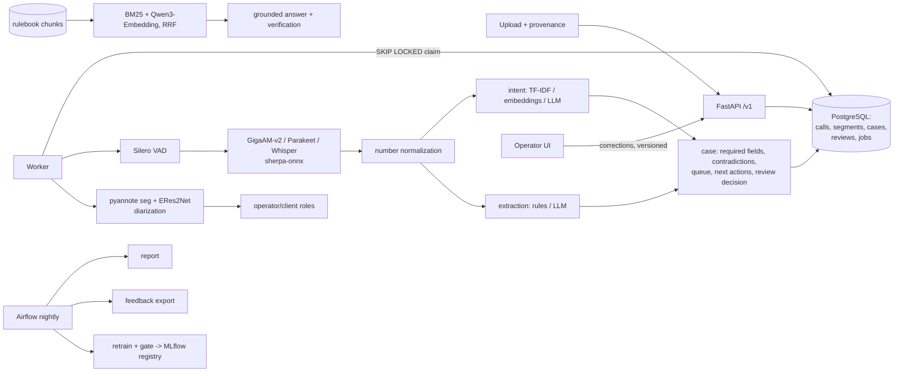

# Architecture

## Key design choices
* Speech and NLP stages are plain functions over typed data (`pipeline.py`), so evaluation
  runs the same code as the worker.
* Russian numerals are normalized deterministically (`domain/ru_numbers.py`): ASR emits
  words, extraction needs digits; dictated groups ("сто двадцать три четыреста пятьдесят
  шесть") are kept as digit strings.
* The case decision is explainable: each review reason is an observable signal.
* Models are versioned in the MLflow registry (`cci-intent@champion`); the worker records the
  model versions it used on every case.

## Trade-offs
* CPU-only ONNX inference keeps the stack portable; GPU would cut ASR latency but is not
  needed for batch post-call processing at contact-center volumes.
* Rules vs LLM extraction is decided by measurement, per condition (see results).
